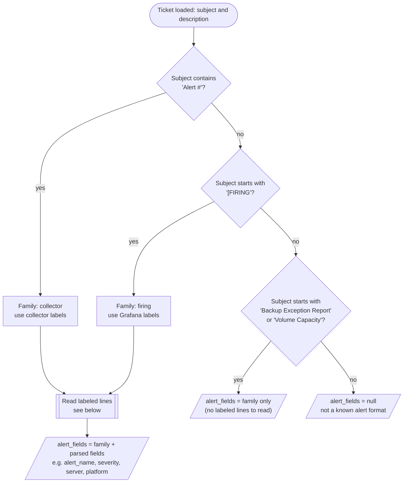

# Alert Parser

How [alert_parser.py](../alert_parser.py) turns an alert ticket into structured
fields. It runs inside `make_ticket` in common.py, so every ticket loaded by
`load_export.py` (or fetched by `fetch_tickets.py`) gets an `alert_fields` value.
The fields are for review, filtering and analysis; they are never sent to the
model.

## Overview

## Reading labeled lines

Each line is trimmed and checked against the family's labels, longest first, so
`Alert Collection` is not read as `Alert` and `PreviousLevel` is not read as
`Level`. Collector lines are `Label value`; Grafana lines are `label value` or
`label = value`.

## Labels and the fields they fill

| Family | Label in the text | Field |
| --- | --- | --- |
| collector | AlertId | alert_id |
| collector | Alert, Alert Collection | alert_name |
| collector | Client Name | client_name |
| collector | Server, Platform, Instance | server, platform, instance |
| collector | Collector Machine, Alias, Keyword | collector, alias, keyword |
| collector | Severity, Level, PreviousLevel / Previous Level | severity, level, previous_level |
| collector | Open Date, OK Collections, Failures | open_date, ok_collections, failures |
| collector | Message, Description, Recommendations | message, description, recommendations (free text) |
| firing | alertname, severity, instance, job, env | alert_name, severity, instance, job, env |
| firing | dimension_DBInstanceIdentifier | db_instance |
| firing | summary, description | summary, description (free text) |

## Coverage on the DW2.0 exports (12,000 tickets, 6,000 alerts)

| Family | Alerts | Most-filled fields |
| --- | --- | --- |
| collector | 5,361 | alert_name 98%, severity 91%, instance 76%, server and platform 57% |
| firing | 203 | alert_name, severity, instance, job, summary 100% |
| backup_exception_report | 412 | family only |
| volume_capacity | 24 | family only |

No human ticket matched an alert format.
