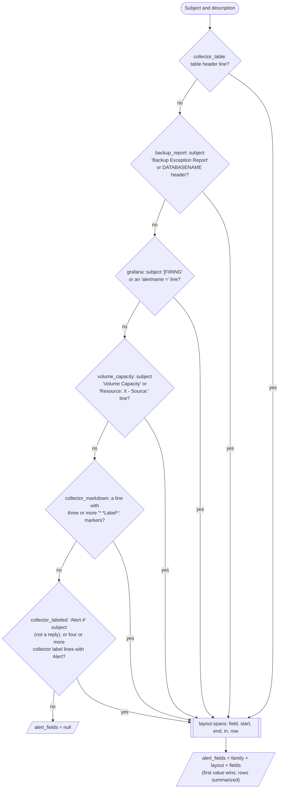
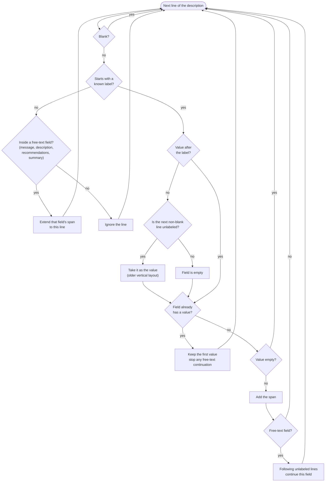

# Alert Parser

How [ticket_analysis/alert_parser.py](../ticket_analysis/alert_parser.py) turns an alert ticket into structured
fields. It runs inside `make_ticket` in ticket_analysis/tickets.py, so every ticket loaded by
`tools/load_export.py` (or fetched by `tools/fetch_tickets.py`) gets an `alert_fields` value.
The fields are for review, filtering, the server detector and analysis; they are
never sent to the model.

Alerts are machine-generated from a few fixed templates. The layouts below were
found with `python -m tools.alert_layouts inventory` (see "Finding the layouts").

## The registry

Each layout is a `Layout(name, family, matches, spans, summarize)` in `LAYOUTS`.
`parse_alert(subject, description)` tries them in order and uses the first whose
`matches` accepts the text. The layout's `spans` function says where each value
sits; the fields are built from the spans.



The table layout is tried first because its alerts also have an "Alert #"
subject. Every layout is recognised by its body as well as its subject, so text
pasted without its subject is parsed.

### Spans and fields

`alert_spans(subject, description)` returns the spans for highlighting:

```python
{"field": "server", "start": 120, "end": 129, "in": "description"}   # or "in": "subject"
{"field": "database", "start": 410, "end": 422, "in": "description", "row": 2}
```

Offsets are into the text as given (no line-ending changes). A field's value is
its span's text; free-text fields (message, description, recommendations,
summary) can span several lines, and their value is the trimmed lines joined by
`\n` (`span_value`). The first span of a field gives its value. Repeated rows
(backup table rows, Grafana alerts in one message) carry a `row` number from 0,
and the layout's `summarize` derives summary fields from them (databases,
backup_rows, alerts).

`SERVER_FIELDS` lists the fields that name the alert's own servers: `server`,
`instance`, `db_instance`, `target` (one name each) and `hosts`,
`backup_servers`, `instancenames`, `instances`, `targets` (lists).
`server_detector.ticket_names()` reads this list: the names label training
examples, fill the known-names directory and fire the `host:alert_field` rule
wherever they appear in the text. "HOST, 1433" is read as HOST,1433.

## Layouts

### collector_labeled

The Fortified Data collector's "Label value" lines. Three template versions:
the original (AlertId, Alert, Client Name, Server, Alias, Platform, Instance,
Message, Severity, Open Date, Failures, OK Collections, Collector Machine, Level,
PreviousLevel, with an optional Keyword line and no Severity then), a newer one
(no Alias, "Previous Level", then Description and Recommendations), and an older
vertical order (each label and value on its own line, no AlertId or Client
Name). CLOSE alerts add Close Date.

Each line is trimmed and checked against the labels, longest first, so
`Alert Collection` is not read as `Alert` and `PreviousLevel` is not read as
`Level`.



| Label in the text | Field |
| --- | --- |
| AlertId | alert_id |
| Alert, Alert Collection | alert_name |
| Client Name | client_name |
| Server, Platform, Instance | server, platform, instance |
| Collector Machine, Alias, Keyword | collector, alias, keyword |
| Severity, Level, PreviousLevel / Previous Level | severity, level, previous_level |
| Open Date, Close Date, OK Collections, Failures | open_date, close_date, ok_collections, failures |
| Message, Description, Recommendations | message, description, recommendations (free text) |

"Collection errors" alerts leave Server and Platform empty and flatten the
details into the message ("ServerName: HOST (SQL Server) Host(s): HOST
Database: ..."). The server, platform and hosts are then taken from the message.
The line "Alert Collection errors" is the alert "Collection errors", not the
label "Alert Collection".

Body recognition needs four or more collector label lines including Alert or
AlertId. A reply ("RE: ... Alert #") is recognised only by such a body.

### collector_markdown

The same labels flattened onto one Markdown line, each value running to the
next marker:

```
* *AlertId*: 4401235 * *Alert*: Low Disk Space * *Client Name*: Fake Co * *Server*: FAKESQL03 * *Alias*: * ...
```

Fields as in the labeled layout; labels outside the collector set are named
after the label in snake case.

### collector_table

Some collector alerts ("Collection errors", "No recent monitoring runs") put
their values in a table:

```
Client Name Environment Name Server Alert Type Open Date (UTC) Message
FAKECO - Zeta (123) ZetaAzureEast (Q9XAB12P) Q9ZZPAP07K Collection errors 2025-01-14 15:30:46 UTC ServerName: Q9ZZPAP07K (SQL Server)
Host(s): Q9ZZPAP07K
Database:
Error Type: SQL Server is unresponsive
First Occurrence: 2025-01-14 15:21:00
Last Occurrence: 2025-01-14 15:26:00
Possible Solutions: Please make sure the server is up and running
```

| Part | Field |
| --- | --- |
| Client name and the number in brackets | client_name, client_id |
| Environment name and the name in brackets | environment, collector (the collector machine) |
| Server column | server (from `ServerName:` in the message when the column is empty) |
| Alert type | alert_name |
| Open date (Close date in the CLOSE header variant), message | open_date or close_date, message |
| Brackets after `ServerName:` | platform (SQL Server, Windows Machine) |
| A "Label: value" message, and every "Label: value" line after the row | the label in snake case: `Host(s):` gives hosts, `Error Type:` error_type, `Minutes Delay:` minutes_delay |

The name in brackets after the environment was called environment_code until
October 2026. In 63 of the 66 sampled alerts it equals a "Collector Machine"
value of the labeled layout and it never equals the alert's own server, so it is
now `collector` and is not a server field. Labels with no value (such as an
empty `Database:`) are left out.

### backup_report

Recognised by the subject ("Backup Exception Report from server HOST") or by
the `DATABASENAME BACKUP TYPE ...` header line.

| Part | Field |
| --- | --- |
| Subject "from server HOST" | server |
| Heading with "SERVER" ("PRODUCTION SERVER: PLEASE INVESTIGATE.") or "missing backup report" | environment_note |
| Table rows: database, type, latest backup date, hours, minutes (row spans) | databases and backup_types (comma-separated, no repeats), backup_rows, max_hours_without |
| Availability Group variant's "LATEST BACKUP SERVER NAME" column | backup_servers |
| Parameter lines anywhere (@HoursForFull, @MinutesForDiff, @MinutesForLog, @DeviceType, @InstanceNames, Report Creation Time) | hoursforfull, minutesfordiff, minutesforlog, devicetype, instancenames, report_creation_time |

Rows are read from the date outwards, so database names may contain spaces. The
Availability Group variant ("## Native BackUp Exception Report:") puts its
parameters before the table and adds a database exclusions table, which is
ignored.

### grafana

Grafana alerts: a "**Labels**" block of `label = value` lines and an
annotations block (description, summary) per alert, several alerts per message.
Each `alertname` line starts a new row; a message with one alert has no rows.

| Label | Field |
| --- | --- |
| alertname, severity, instance, job, env | alert_name, severity, instance, job, env |
| dimension_DBInstanceIdentifier | db_instance |
| summary, description | summary, description (free text, up to the "Source" or a `**...**` line) |
| target, DatabaseName, Status, region, name and any other `key = value` label | target, database, status, region, name, ... |
| Several alerts | alerts (the number), instances and targets (when they differ), other fields from the first alert that has them |

`target` is the monitored SQL Server endpoint (93 of 94 sampled targets are
known DW2.0 servers); `instance` is usually the exporter. Both are server
fields. Body recognition needs an `alertname =` line, which also covers the
"[WARNING] Alert" and "[CRITICAL] Alert" subjects of the same template.

### volume_capacity

Monitoring alerts with a subject "Volume Capacity-C:\ on HOST ... that ...
has a value of N" and a body of "Label:" lines around one detail line:

```
LMD1234567890 critical - Volumes - Fake Group - Resource: FAKESQL06 - Source: Volume Capacity-C:\ Metric: PercentUsed value reported: 91.2345 on: ... on host FAKESQL06 is now 91.2345 percent used, as of 2026-07-21 10:00:00 EDT.
```

| Part | Field |
| --- | --- |
| Subject | alert_name (Volume Capacity), volume, server |
| Detail line | alert_id, severity, server (Resource), source, metric, value, hosts (on host), percent_used, open_date, time_zone |
| Other "Label: value" lines (a label with no value takes the next line) | the label in snake case: incident_opened_by, datasource, datapoint, alert_rule, recipients ... |

The subject, Resource and "on host" name the same server in all 24 sampled
alerts. Other alerts of the same template (another datasource in the subject)
are recognised by the detail line and get their server from Resource.

## Commands

```
python -m tools.alert_parser coverage data\train_tickets.jsonl data\test_tickets.jsonl
python -m tools.alert_parser data\train_tickets.jsonl data\test_tickets.jsonl ...
python -m tools.alert_layouts inventory [--tickets ...]
```

`coverage` prints, per layout, the alerts (is_alert tickets), the share parsed
with fields beyond the family, the share with a server (a server-shaped value in
`SERVER_FIELDS`), the most-filled fields, and the human tickets the layout
matches. The second form re-parses `alert_fields` in place: the ticket files
keep the fields parsed when they were built, so run it after a parser change
(back the files up first), then retrain the server detector.

## Coverage (12,000-ticket sample, 6,000 alerts, October 2026)

| Layout | Alerts | Parsed | With a server | Most-filled fields | Human tickets matched |
| --- | --- | --- | --- | --- | --- |
| collector_table | 68 | 100% | 94% | environment, client_name, alert_name, message, collector, client_id 100% | 0 |
| backup_report | 412 | 100% | 100% | server 100%, databases, backup_types, backup_rows, max_hours_without 99%, hoursforfull 98% | 1 |
| grafana | 203 | 100% | 100% | description, alert_name, summary, severity, job, instance 100% | 185 |
| volume_capacity | 24 | 100% | 100% | value, datasource, datapoint, alert_name, metric, percent_used 100% | 16 |
| collector_markdown | 7 | 100% | 100% | ok_collections, platform, client_name, message, severity, open_date 100% | 0 |
| collector_labeled | 5,280 | 100.0% | 99.2% | alert_name, message, ok_collections, open_date, failures, level 100% | 333 |
| unrecognised | 6 | 0% | 0% | | 0 |
| All alerts | 6,000 | 99.9% | 99.1% | recognised 99.9% | 535 |

Before this registry, 98% of alerts had a server and Volume Capacity alerts had
none.

Below 95% with a server:

- collector_table (94%): the 4 alerts without a server are collector-health
  alerts ("No recent monitoring runs", "No recent collections") that name only
  the collector machine.
- collector_labeled is above 95%, but its 42 alerts without a server are of
  the same kind: 41 collector-health alerts ("No recent collections", "Low
  Space on the Collector's Management Drive", "No recent monitoring runs") and
  one with neither an alert name nor a server.

The 6 unrecognised alerts are replies flagged as alerts ("RE: ... Update:
Alert #" or "Re: Alert #" with reply text only, one of them a decommissioning
note).

### Human tickets that match a layout

535 tickets that DW2.0 flags as human match a layout by their body. They are
alerts by structure: the 333 labeled ones are collector alerts in full (every
line is template text) whose subject lacks "Alert #", the 185 Grafana ones use
"[WARNING] Alert" or "[CRITICAL] Alert" subjects, and the 16 Volume Capacity
ones are other alerts of the same monitoring template. The server detector
treats any ticket with alert fields as an alert (`is_alert_ticket`), so these
are now labeled from their alert fields, like other alerts.

## Finding the layouts

`python -m tools.alert_layouts inventory` reduces each alert to its layout signature:
the ordered template labels and header lines of the description (values
removed) plus the subject's template words up to "Alert #". Labels seen in
fewer than 10 alerts are treated as free text and the external-email banner
("CAUTION:") is dropped; repeated blocks (several Grafana alerts) are kept once.
Signatures join a layout when they differ from its most common signature by at
most two lines (one for short signatures), when one is contained in the other in
order, or when they share a column header line.

The report (data/reports/alert-layouts-<timestamp>.md) lists, per layout, the
alert count, the families and masked alert names, the required and optional
lines, the parser's coverage and a masked example; data/alert_layouts/ has one
masked example file per layout. A word is kept only when it is a parser label or
appears in the alerts of eight or more organizations and is not part of an
organization, server, client, environment or collector name, or a greeting or
sign-off. Every other word becomes its shape (SQL01 becomes L3 D2).
