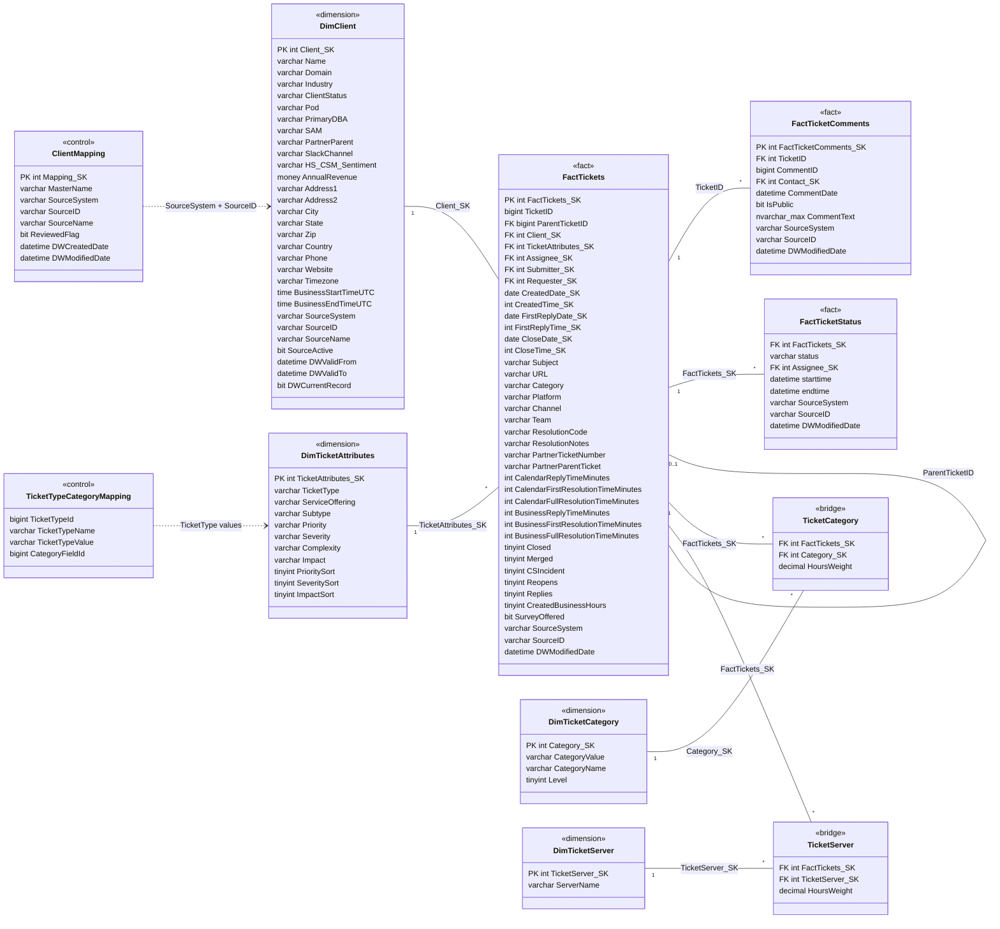

# DW2.0 Ticket Schema

The DW2.0 tables that hold Zendesk tickets, their comments, categories, servers and
clients, as exported from `FDReportingDev` on 2026-10-16. The export contained no
foreign keys, so the relationships below are inferred from column names. Confirm
them with the DW2.0 maintainers before relying on them.

Rendered version: [DW2.0 Ticket Schema artifact](https://claude.ai/artifact/Y7Q3tTUPZ8sVboe475m7Z2?sk=y4wzU1OFXidkl0AifJkxHg)

Legend: `PK` primary or surrogate key, `FK` inferred reference. Stereotypes give
each table's role: fact, dimension, bridge or control.

`ClientMapping` and `TicketTypeCategoryMapping` are in the `control` schema; all
other tables are in `dbo`.

## Reading the relationships

- Solid lines are joins implied by matching key names. Dotted lines are looser
  lookups through source system values, not keys.
- `FactTicketComments` joins on `TicketID`, not the surrogate key, and stores it
  as `int` where `FactTickets` uses `bigint`.
- `DimClient` keeps history (`DWValidFrom`, `DWValidTo`, `DWCurrentRecord`), so a
  ticket points at the client record that was current when the ticket loaded.
- `TicketCategory` and `TicketServer` carry `HoursWeight`, which suggests they
  come from time entries rather than from the ticket itself.
- Assignee, submitter, requester, contact and date keys point to dimensions that
  were not in this export, so they are not drawn.

## What the classifier export uses

- `FactTickets`: `TicketID`, `Subject`, `CreatedDate_SK`, `Category`, and `Merged`
  as a filter.
- `FactTicketComments`: the earliest `CommentText` per ticket, used as the
  description (in Zendesk the description is the first comment).
- `DimClient`: `Name`, plus `SourceID` when `SourceSystem` is Zendesk (the Zendesk
  organization id).
- `DimTicketAttributes`: `TicketType` and `Subtype` as weak labels.
- `DimTicketCategory` through `TicketCategory`: category names as weak labels.
- `DimTicketServer` through `TicketServer`: server names, kept as `dw_servers`, a
  candidate check on the model's server mentions.
